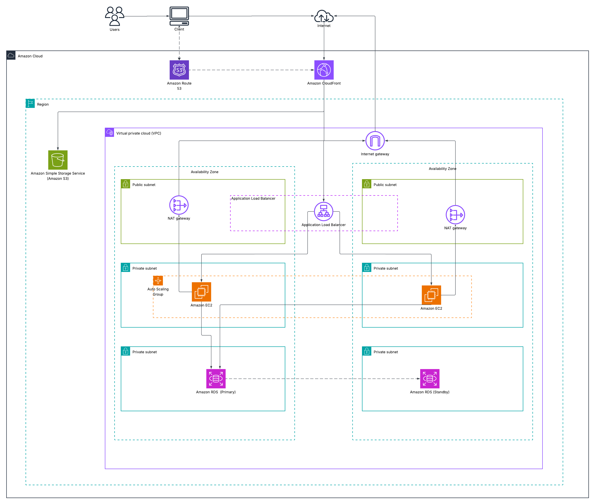

# 

> **React / Vite + SWC / Express.js / Sequelize / MySQL codebase containing real world examples (CRUD, auth, advanced patterns, etc) that adheres to the [RealWorld](https://realworld.io/) spec and API.**

This codebase was created to demonstrate a fully fledged fullstack application built with **React / Vite + SWC / Express.js / Sequelize / MySQL** including CRUD operations, authentication, routing, pagination, and more.

**[Demo app](https://conduit-realworld-example-app.fly.dev/)&nbsp;&nbsp;|&nbsp;&nbsp;[With Create React App](https://github.com/TonyMckes/conduit-realworld-example-app/tree/create-react-app)&nbsp;&nbsp;|&nbsp;&nbsp;[Other RealWorld Example Apps](https://codebase.show/projects/realworld?category=fullstack)**

> For more information on how to this works with other frontends/backends, head over to the [RealWorld](https://github.com/gothinkster/realworld) repo.

---

## Getting Started

These instructions will help you install and run the project on your local machine for development and testing.

### Prerequisites

Before you run the project, make sure that you have the following tools and software installed on your computer:

- Text editor/IDE (e.g., VS Code, Sublime Text, Atom)
- [Git](https://git-scm.com/downloads)
- [Node.js](https://nodejs.org/en/download/) `v22+` (see [`.nvmrc`](.nvmrc))
- [NPM](https://www.npmjs.com/) (usually included with Node.js)
- SQL database

### Installation

To install the project on your computer, follow these steps:

1. Clone the repository to your local machine.

   ```bash
   git clone https://github.com/TonyMckes/conduit-realworld-example-app.git
   ```

2. Navigate to the project directory.

   ```bash
   cd conduit-realworld-example-app
   ```

3. Install project dependencies by running the command:

   ```bash
   npm install
   ```

### Configuration

1. Create a `.env` file in the `backend` directory (the backend and `sequelize-cli` load it from there)
2. Add the required environment variables as specified in the [`.env.example`](backend/.env.example) file. Keep `DB_SYNC=true` for local development so the schema is synced on startup.
3. (Optional) update the Sequelize configuration parameters in the [`config.js`](backend/config/config.js) file
4. If you are **not** using MySQL, you may also have to install the driver for your database:

   <details>
   <summary>Use one of the following commands to install:</summary><br/>

   > Note: `-w backend` option is used to install it in the backend [`package.json`](backend/package.json).

   ```bash
   npm install -w backend mysql2        # MySQL (already installed)
   npm install -w backend pg pg-hstore  # Postgres
   npm install -w backend mariadb
   npm install -w backend sqlite3
   npm install -w backend tedious       # Microsoft SQL Server
   npm install -w backend oracledb      # Oracle Database
   ```

   > :information_source: Visit [Sequelize - Installing](https://sequelize.org/docs/v6/getting-started/#installing) for more infomation.

   ***

   </details>

5. Create database specified by configuration by executing

   > :warning: Please, make sure you have already created a user with the necessary privileges for your database.

   ```bash
   npm run sqlz -- db:create
   ```

   > :information_source: The command `npm run sqlz` is an alias for `npx -w backend sequelize-cli`.  
   > Execute `npm run sqlz -- --help` to see more of `sequelize-cli` commands availables.

6. Create the tables, either by starting the backend with `DB_SYNC=true` or by running the migrations:

   ```bash
   npm run sqlz -- db:migrate
   ```

7. Optionally you can run the following command to populate your database with some dummy data:

   ```bash
   npm run sqlz -- db:seed:all
   ```

### Usage

#### Development Server

To run the project, follow these steps:

1. Start the development server by executing the command:

   ```bash
   npm run dev
   ```

2. Open a web browser and navigate to:
   - Home page should be available at [`http://localhost:3000/`](http://localhost:3000).
   - API endpoints should be available at [`http://localhost:3001/api`](http://localhost:3001/api).

#### Running Tests

To run tests, simply run the following command:

```bash
npm run test
```

#### Production build

The frontend and backend are built and run separately:

```bash
npm run build   # frontend static files -> frontend/dist
npm run start   # backend API only (no longer serves the frontend)
```

## Deploying (Phase 2: client/server)



The frontend is a static site in **S3**, and the backend runs on **EC2** instances in an Auto Scaling group behind an **ALB**, with **RDS** (MySQL) as the database. **CloudFront** serves both under one domain:

| CloudFront behavior | Origin | Notes |
| --- | --- | --- |
| `/api/*` | ALB | API (see settings below) |
| Default (`*`) | S3 bucket (OAC) | Static frontend, default root object `index.html` |

The browser calls `/api/*` on the same origin, so no CORS setup is needed.

### Configuration

**Frontend** ([`frontend/.env.example`](frontend/.env.example)), baked in at build time:

| Variable | Description |
| --- | --- |
| `VITE_API_URL` | Leave empty to call `/api/*` on the same origin (Phase 2). Set it to an absolute URL only when the API is on another host, and add the frontend origin to the backend's `CORS_ORIGIN`. |

**Backend** ([`backend/.env.example`](backend/.env.example)), read from SSM Parameter Store on EC2:

| Variable | Description |
| --- | --- |
| `JWT_KEY` | Secret used to sign tokens (SecureString) |
| `PROD_DB_HOSTNAME` / `PROD_DB_PORT` | RDS endpoint and port |
| `PROD_DB_USERNAME` / `PROD_DB_PASSWORD` / `PROD_DB_NAME` | Database credentials (password as SecureString) |
| `PROD_DB_DIALECT` / `PROD_DB_LOGGING` | `mysql` / `false` |
| `ORIGIN_VERIFY_SECRET` | Optional. When set, `/api/*` requires a matching `X-Origin-Verify` header (SecureString) |
| `CORS_ORIGIN` | Optional comma-separated allowlist. Unset allows any origin. Not needed in Phase 2. |
| `DB_SYNC` | **Leave unset.** `true` runs `sequelize.sync({ alter: true })` on startup, which is for development only. |

`NODE_ENV=production` and `PORT=3001` are set by the user-data script.

### Frontend → S3

```bash
S3_BUCKET=my-conduit-frontend \
CLOUDFRONT_DISTRIBUTION_ID=E123EXAMPLE \
deploy/frontend/deploy-s3.sh
```

[`deploy-s3.sh`](deploy/frontend/deploy-s3.sh) builds the frontend and syncs it to the bucket. Hashed files in `assets/` are cached for a year, everything else uses `no-cache`. It then invalidates `index.html`.

The app uses `HashRouter` (`/#/article/...`), so CloudFront and S3 always request `/` and **no SPA fallback is needed**. Don't add distribution-wide 403/404 → `index.html` custom error responses, because they would also rewrite API 404s into `200 index.html`.

### Backend → EC2 (Auto Scaling group)

1. Store the backend variables above as SSM parameters under one path, e.g. `/conduit/prod/JWT_KEY`, `/conduit/prod/PROD_DB_PASSWORD`, …
2. Give the instance role `AmazonSSMManagedInstanceCore`, `ssm:GetParametersByPath` on that path, and `kms:Decrypt` for the SecureString key.
3. Set `REPO_URL`, `GIT_REF` and `SSM_PREFIX` at the top of [`deploy/backend/user-data.sh`](deploy/backend/user-data.sh) and use it as the launch template's user data (Amazon Linux 2023). On boot, it:
   - installs Node.js;
   - checks out `GIT_REF` into `/opt/conduit`;
   - runs `npm ci --omit=dev -w backend`;
   - writes `/etc/conduit/backend.env` from SSM;
   - starts the [`conduit-backend`](deploy/backend/conduit-backend.service) systemd service on port 3001.

   Instances in private subnets need the NAT gateway to reach GitHub, nodejs.org and npm. If the repository is private, the clone needs credentials, or you can switch the script to fetch a build artifact from S3.
4. Set the ALB target group to HTTP on port `3001`, with health check path **`/health`**. This liveness check doesn't touch the database, so an RDS failover won't make the ASG replace healthy instances.
5. To roll out a new version, update `GIT_REF` in the launch template and start an instance refresh, after running migrations (below).

Logs: `journalctl -u conduit-backend` and `/var/log/conduit-user-data.log`.

### Database migrations

Schema changes in deployed environments go through migrations, never `sync`. Run them **once per deploy, on one instance**, before rolling out the rest. RDS is in a private subnet, so run them over SSM:

```bash
aws ssm send-command \
  --instance-ids i-0123456789abcdef0 \
  --document-name AWS-RunShellScript \
  --parameters 'commands=["bash /opt/conduit/deploy/backend/migrate.sh"]'
```

[`migrate.sh`](deploy/backend/migrate.sh) runs `sequelize-cli db:migrate` with the service's own environment file. Pass `db:migrate:status` as an argument to inspect state.

- Don't run migrations from user-data. Every new instance would try them again.
- Keep migrations backward compatible. During a rolling deploy, old and new code share the database, so add columns first and remove old ones in a later release.
- **Database first created with `sync`** (e.g. data migrated from Phase 1): the tables already exist, so mark the migrations as applied instead of running them:

  ```sql
  INSERT INTO SequelizeMeta (name) VALUES
    ('20220129140530-create-tag.js'), ('20220129140808-create-article.js'),
    ('20220129140956-create-user.js'), ('20220129141319-create-comment.js'),
    ('20261019000000-add-associations.js');
  ```

  If `SequelizeMeta` doesn't exist yet, run `migrate.sh db:migrate:status` once first, which creates it.

### CloudFront `/api/*` behavior

- **Cache policy:** `CachingDisabled`
- **Origin request policy:** `AllViewerExceptHostHeader`. This forwards `Authorization: Token …`; if it's stripped, every logged-in request fails.
- **Allowed methods:** `GET, HEAD, OPTIONS, PUT, POST, PATCH, DELETE`
- **Path:** CloudFront does not strip the `/api` prefix, which matches the backend routes.
- **Origin custom header (optional):** `X-Origin-Verify: <ORIGIN_VERIFY_SECRET>`

Lock the ALB to CloudFront: allow inbound traffic on its security group only from the `com.amazonaws.global.cloudfront.origin-facing` managed prefix list. Optionally also set `ORIGIN_VERIFY_SECRET`, so requests that bypass the edge get `403`. The ALB's `/health` checks are not under `/api`, so they are unaffected.

## License

This project is licensed under the MIT License. See the [LICENSE](LICENSE) file for details.

## Acknowledgments

- [RealWorld](https://realworld.io/)
- [RealWorld (GitHub)](https://github.com/gothinkster/realworld)
- [CodebaseShow](https://codebase.show/)
- [How to write a Good readme](https://bulldogjob.com/news/449-how-to-write-a-good-readme-for-your-github-project)
